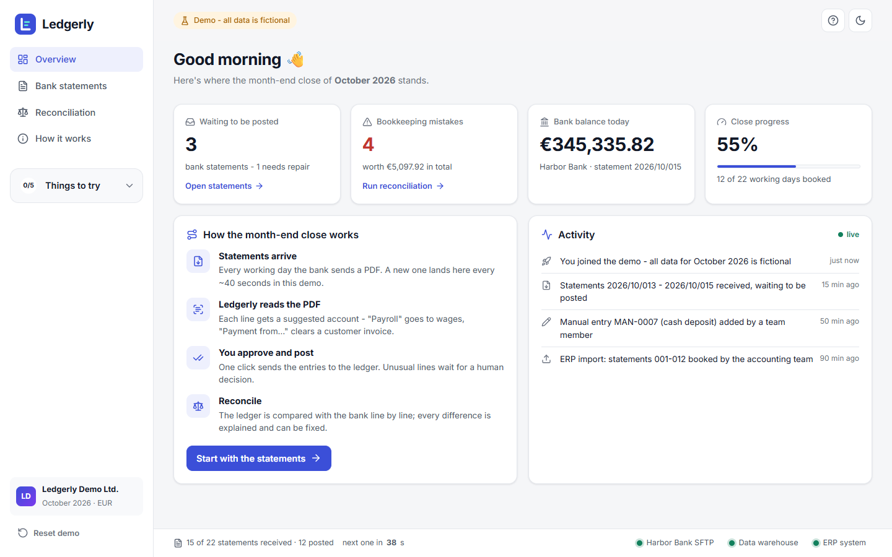
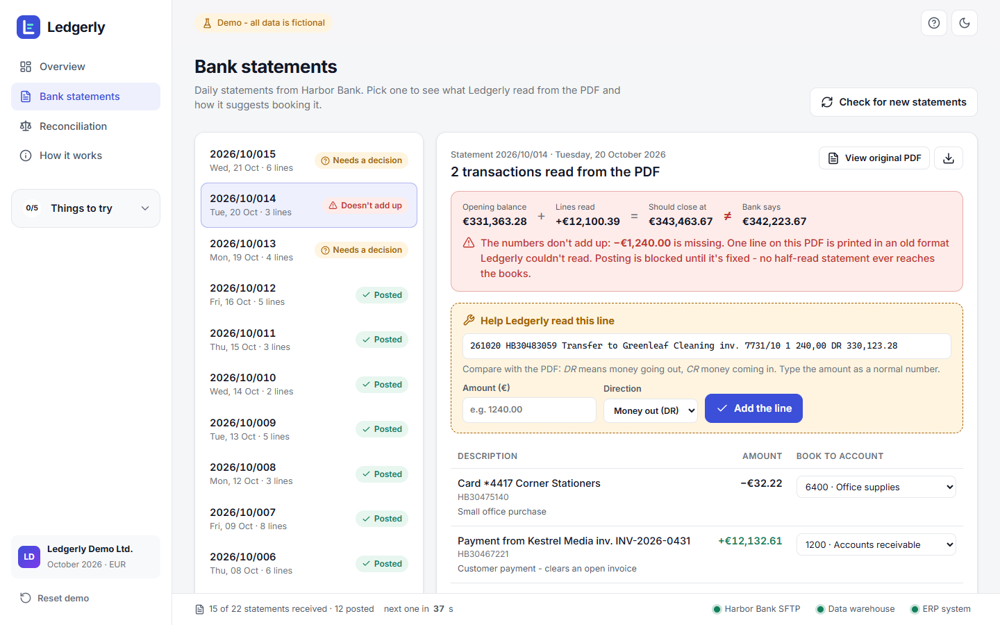
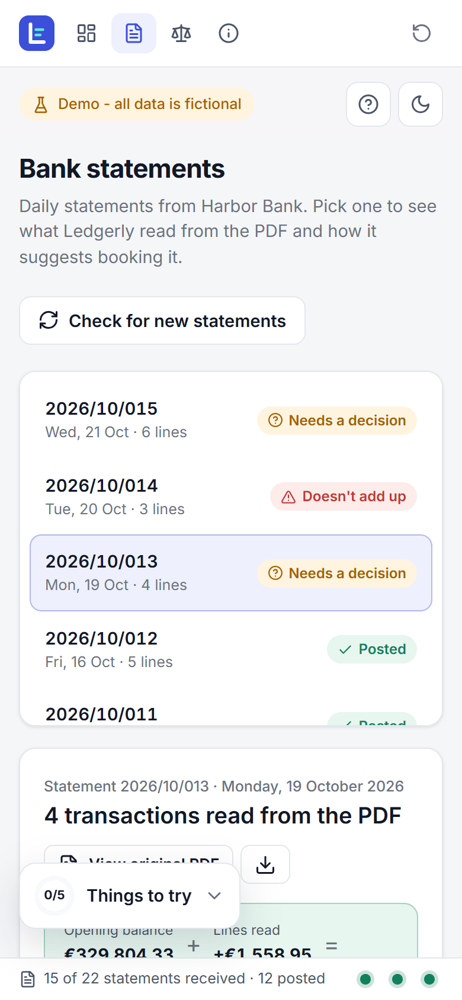
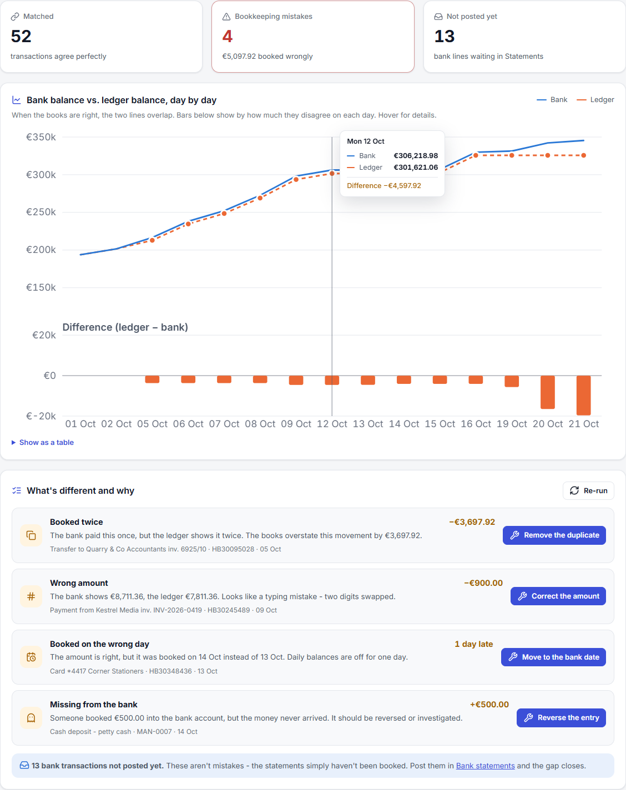

# Ledgerly

**A small finance back-office tool that reads bank statement PDFs, posts them to the ledger and proves the books match the bank.**

[](https://github.com/pawelmarszl-byte/wizytowka/actions/workflows/ci.yml)


### ▶ [Try the live demo](https://pawelmarszalek.onrender.com/demo) · [About the author](https://pawelmarszalek.onrender.com)

> Hosted on Render's free tier. If nobody has visited for a while, **the first load takes ~30 seconds** while the server wakes up.
> Everything is fictional: the bank, the company and every number.



---

## The problem

Every company has to show that its books agree with its bank account. Done by hand, that means downloading
statements, retyping lines into the accounting system and hunting for differences in spreadsheets. It's slow, and
the classic mistakes slip through: a payment booked twice, two digits swapped, an entry dated a day late.

I built an internal tool that automates this for my own work in finance. **Ledgerly is a public rewrite of that
idea**, built from scratch on invented data so anyone can try it.

## What you can do in the demo

| | |
|---|---|
| **Watch statements arrive** | Three PDFs from the (fictional) Harbor Bank are waiting. Post one and a fresh statement arrives about 40 seconds later. |
| **Open the real PDF** | Every statement is a genuine PDF ([sample](docs/sample-statement.pdf)) that Ledgerly parses back from text. |
| **Approve bookings** | Each line gets a suggested account from simple rules. Lines no rule recognises wait for you, with a hint. |
| **Repair a broken statement** | One PDF prints a line in an old format. The balance check (opening + lines ≠ closing) catches it and blocks posting until you fix it. |
| **Reconcile** | Bank vs. ledger, line by line. Four planted mistakes are found, explained in plain English and fixed with correcting entries. |
| **Close the accruals** | Settle last month's estimates against real invoices (exact, within tolerance, over tolerance with a reason, never invoiced), book this month's accruals from contracts and invoice history, then tie the accrued-expenses account and sign off. |
| **Break things** | Click a dot in the status bar to simulate an outage (bank, data warehouse, ERP) and see how the app behaves. |

A *Things to try* checklist in the sidebar guides first-time visitors.

The site root (`/`) is a personal page about the author, with Ledgerly as the featured project; the app itself lives under `/demo`.

<p>
  
  
</p>



## How it works

```
 ┌──────────────┐  PDF   ┌─────────────┐  suggested   ┌──────────┐
 │ Harbor Bank  │ ─────► │  PDF parser │ ───────────► │  Review  │ ── post ──┐
 │ (simulated)  │        │ + balance   │   accounts   │  (you)   │           ▼
 └──────────────┘        │   check     │              └──────────┘     ┌──────────┐
                         └─────────────┘                               │  Ledger  │
                                                                       └────┬─────┘
                ┌──────────────────────────────────────────────────────────┘
                ▼
       ┌──────────────────┐   per-reference comparison:  matched · duplicate ·
       │  Reconciliation  │   wrong amount · wrong day · ledger-only · unposted
       └──────────────────┘   → plain-English explanation + correcting entry
```

* **Server-rendered UI with HTMX.** Every click returns a small HTML fragment. No front-end framework and no
  build step; JavaScript only adds icons, toasts and chart hover.
* **Real PDF round-trip.** `fpdf2` renders statements and `pypdf` reads them back. The "doesn't add up" check is
  computed from parsed text, not scripted.
* **Reconciliation by shape.** For each transaction reference the bank's `{date: amount}` map is compared with the
  ledger's. The *shape* of the difference identifies the mistake (same total on another day = timing; N× the amount =
  duplicate, …). Fixes are new correcting entries, so the audit trail stays intact.
* **Accruals as a three-step process.** Last month's accruals are reversed on day 1 and settled against the real
  invoices; differences above a 5 % tolerance need a reason. This month's proposals show their basis (contract,
  3-month average, annual fee / 12, carried forward). A proposal for a cost that is already invoiced blocks booking,
  and the 2400 roll-forward must tie to the ledger before sign-off locks the period.
* **Charts drawn on the server** as SVG (no chart library). The colour pair was checked for colour-blind separation
  in light and dark mode.
* **Isolated sessions.** Each visitor gets an in-memory copy of the month (cookie-keyed, expires after 3 h), so many
  people can click at once without seeing each other's changes. This suits a free host with an ephemeral disk.
* **Deterministic data.** One seed generates the whole month, including the planted mistakes, so tests and
  screenshots are reproducible.

## Project layout

```
app/
  domain/            pure Python, no web code
    generator.py     fictional month of bank data + planted bookkeeping mistakes
    statement_pdf.py render a statement PDF and parse it back
    posting.py       rule-based account suggestions
    reconciliation.py bank vs. ledger comparison and correcting entries
    accruals.py      month-end accruals: settle, propose, book, roll-forward, sign-off
  state.py           per-visitor session: arrivals, outages, postings, missions
  main.py            FastAPI routes: personal page at /, the demo at /demo (+ HTMX fragments)
  web/chart.py       server-side SVG chart
  templates/         Jinja2 pages and partials
  static/            CSS, a little JS, vendored htmx + lucide icons
tests/               domain, HTTP flow, and a "no real company names" guard
```

## Run locally

```bash
python -m venv .venv && source .venv/bin/activate   # Windows: .venv\Scripts\activate
pip install -r requirements-dev.txt
uvicorn app.main:app --reload
# open http://127.0.0.1:8000
```

Tests: `python -m unittest discover tests` (set `LEDGERLY_FAST=1` to skip the simulated network delay; the
web tests do this automatically).

## Deploy your own (free)

1. Push this repo to GitHub.
2. On [render.com](https://render.com): **New → Blueprint** → pick the repo. `render.yaml` sets everything up
   (free web service, health check at `/healthz`).

## Tech

Python 3.12 · FastAPI · Jinja2 · HTMX · fpdf2 · pypdf · SVG · GitHub Actions · Render

---

**Author:** Paweł Marszałek · [LinkedIn](https://www.linkedin.com/in/pawe%C5%82-marsza%C5%82ek-02928b98/)

<sub>All names, accounts and amounts are randomly generated. Harbor Bank and Ledgerly Demo Ltd. are fictional.</sub>
